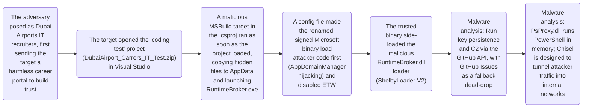

# Blinder Tunnel Campaign Targets Iraqi Infrastructure

* **Link:** [Unit 42 - Blinder Tunnel Targets Critical Infrastructure](https://unit42.paloaltonetworks.com/blinder-tunnel-targets-critical-infrastructure/)[cite: 14]
* **Source:** Unit 42 (Palo Alto Networks) — "Blinder Tunnel Campaign Targets Critical Infrastructure" (Published: October 6, 2026)[cite: 14]
* **Students:** Shir Jermiahu, Orian Reuven[cite: 14]

---

## CTI Report Summary

This CTI report documents a cyber espionage campaign tracked as “Blinder Tunnel,” attributed by Unit 42 with high confidence to an Iranian state-aligned threat actor tracked as CL-STA-1178[cite: 14]. In March 2026, the attackers targeted a specific individual, likely a software engineer, in Iraq’s critical infrastructure sector, following infrastructure staging observed as early as November 2025[cite: 14].

The apparent objective was to establish covert, persistent access that could be extended into internal networks[cite: 14]. The intrusion relied on targeted social engineering: the attackers posed as recruiters from the Dubai Airports IT department, first sending the target a harmless career portal to build trust, and then a weaponized coding challenge inside an archive named `DubaiAirport_Carrers_IT_Test.zip`[cite: 14].

Simply opening the project in Visual Studio, before any compilation, caused MSBuild to run a malicious target in the `.csproj` file[cite: 14]. AppDomainManager hijacking and DLL side-loading then loaded the malicious loader inside a renamed, signed Microsoft binary[cite: 14]. The malware used `PsProxy.dll` to run PowerShell commands in memory, the GitHub API for command and control with GitHub Issues as a fallback dead-drop resolver, and Chisel to create reverse SOCKS5 tunnels designed to route attacker traffic into internal networks[cite: 14]. Cortex XDR detected and blocked the execution chain, so the later stages describe malware capabilities rather than confirmed activity on the victim’s host[cite: 14].

---

## Attack Chain Execution Flow

---

## Map behaviors to ATT&CK:

| SOC telemetry / investigation | Evidence and mapping rationale | Technique / ID | ATT&CK tactic | Observed behavior |
| :--- | :--- | :--- | :--- | :--- |
| **Process creation logs (Sysmon Event ID 1 / Windows 4688):** `MSBuild.exe` or `devenv.exe` spawning an executable from `%LOCALAPPDATA%`. Check the parent process and the origin of the project archive[cite: 14] | The report shows the `.csproj` configuration overriding the `GetFrameworkPaths` target, and explicitly names the technique. Execution is proxied through `msbuild.exe`, a trusted developer tool, which hides the malicious activity behind expected IDE behavior[cite: 14] | Trusted Developer Utilities Proxy Execution: MSBuild (T1127.001)[cite: 14] | Defense Evasion[cite: 14] | Opening the project in Visual Studio caused MSBuild to run a malicious target defined in the `.csproj` file, which copied hidden binaries to AppData and launched `RuntimeBroker.exe`[cite: 14] |
| **Process creation telemetry (`devenv.exe`, `MSBuild.exe`);** examine command line and correlate with preceding ZIP extraction[cite: 14] | Report shows execution triggered when the victim extracted the archive and opened the project in Visual Studio[cite: 14] | Malicious File (T1204.002)[cite: 14] | Execution[cite: 14] | Target opens project inside Visual Studio[cite: 14] |
| **Module load logs (Sysmon Event ID 7);** verify DLL path, digital signature, and inspect host process
