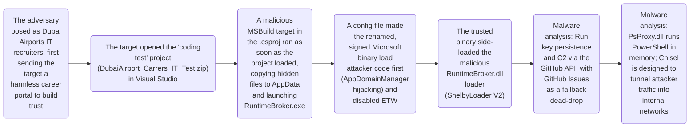

# Blinder Tunnel Campaign Targets Iraqi Infrastructure

* **Link:** [Unit 42 - Blinder Tunnel Targets Critical Infrastructure](https://unit42.paloaltonetworks.com/blinder-tunnel-targets-critical-infrastructure/)
* **Source:** Unit 42 (Palo Alto Networks) — "Blinder Tunnel Campaign Targets Critical Infrastructure" (Published: October 6, 2026)
* **Students:** Shir Jermiahu, Orian Reuven

---

## CTI Report Summary

This CTI report documents a cyber espionage campaign tracked as “Blinder Tunnel,” attributed by Unit 42 with high confidence to an Iranian state-aligned threat actor tracked as CL-STA-1178. In March 2026, the attackers targeted a specific individual, likely a software engineer, in Iraq’s critical infrastructure sector, following infrastructure staging observed as early as November 2025.

The apparent objective was to establish covert, persistent access that could be extended into internal networks. The intrusion relied on targeted social engineering: the attackers posed as recruiters from the Dubai Airports IT department, first sending the target a harmless career portal to build trust, and then a weaponized coding challenge inside an archive named `DubaiAirport_Carrers_IT_Test.zip`.

Simply opening the project in Visual Studio, before any compilation, caused MSBuild to run a malicious target in the `.csproj` file. AppDomainManager hijacking and DLL side-loading then loaded the malicious loader inside a renamed, signed Microsoft binary. The malware used `PsProxy.dll` to run PowerShell commands in memory, the GitHub API for command and control with GitHub Issues as a fallback dead-drop resolver, and Chisel to create reverse SOCKS5 tunnels designed to route attacker traffic into internal networks. Cortex XDR detected and blocked the execution chain, so the later stages describe malware capabilities rather than confirmed activity on the victim’s host.

---

## Attack Chain Execution Flow

---

## Map behaviors to ATT&CK:

| SOC telemetry / investigation | Evidence and mapping rationale | Technique / ID | ATT&CK tactic | Observed behavior |
| :--- | :--- | :--- | :--- | :--- |
| **Process creation logs (Sysmon Event ID 1 / Windows 4688):** `MSBuild.exe` or `devenv.exe` spawning an executable from `%LOCALAPPDATA%`. Check the parent process and the origin of the project archive | The report shows the `.csproj` configuration overriding the `GetFrameworkPaths` target, and explicitly names the technique. Execution is proxied through `msbuild.exe`, a trusted developer tool, which hides the malicious activity behind expected IDE behavior | Trusted Developer Utilities Proxy Execution: MSBuild (T1127.001) | Defense Evasion | Opening the project in Visual Studio caused MSBuild to run a malicious target defined in the `.csproj` file, which copied hidden binaries to AppData and launched `RuntimeBroker.exe` |
| **Process creation telemetry (`devenv.exe`, `MSBuild.exe`);** examine command line and correlate with preceding ZIP extraction | Report shows execution triggered when the victim extracted the archive and opened the project in Visual Studio | Malicious File (T1204.002) | Execution | Target opens project inside Visual Studio |
| **Module load logs (Sysmon Event ID 7);** verify DLL path, digital signature, and inspect host process memory | Report describes file configuration abusing AppDomainManager hijacking to load a managed malicious DLL | Hijack Execution Flow: AppDomainManager (T1574.014) | Defense Evasion | Config file of a renamed signed binary forces it to load a rogue DLL |
| **PowerShell Script Block logging (Event ID 4104) and module load telemetry (Sysmon Event ID 7);** detect unexpected processes loading `System.Management.Automation.dll` and inspect executed script blocks for encoded commands or AMSI bypass | Report details `PsProxy.dll` invoking PowerShell runspaces directly in-memory without spawning `powershell.exe` | PowerShell (T1059.001) | Execution | PsProxy executes PowerShell commands in-memory |
| **Web proxy and DNS logs:** regular, repeated HTTPS requests to `api.github.com` from `RuntimeBroker.exe`, a process that should not contact GitHub. Check the requested repository against the report’s IOCs | The report shows the loader uploading a host fingerprint to a file in the attackers’ GitHub repository and polling another file for commands, so the same service is used to send and receive data. If the token is revoked, it searches GitHub Issues comments for encrypted new C2 details, which matches a dead drop resolver | Web Service: Bidirectional Communication (T1102.002) | Command and Control | Malware communicates with operators via the GitHub API |
| **Network flow and EDR network connection logs (Sysmon Event ID 3):** detect long-lived outbound TCP/WebSocket sessions initiated by `vshost32.exe` and correlate destination IPs against CTI indicators | Report describes deploying the open-source Chisel utility to route external traffic into internal infrastructure | Protocol Tunneling (T1572) | Command and Control | Threat actor deploys Chisel to establish reverse SOCKS5 proxy |

---

## SOC investigation notes:

### Behavior: Target opens project inside Visual Studio (T1204.002 / MSBuild.exe)
* **Telemetry Sources:**
  * Endpoint Process Creation logs (Windows Event ID 4688 / Sysmon Event ID 1) capturing `devenv.exe` invoking `MSBuild.exe`.
  * File Creation logs capturing dropped files inside `%LOCALAPPDATA%\Microsoft\RuntimeBrokers`.
* **Tier 1 Analyst (Triage):**
  * **Role and Context Verification:** Verify whether the alert originated from a developer workstation or an administrative/finance host where source code compilation is abnormal.
  * **Command Line Inspection:** Examine the command-line switches passed to `MSBuild.exe` to check for unexpected parameters, inline execution instructions, or execution from non-standard folder paths.
  * **Parent-Child Process Relationship:** Detect `MSBuild.exe` spawning a rogue `RuntimeBroker.exe` from AppData (`%LOCALAPPDATA%\Microsoft\RuntimeBrokers`) rather than the standard System32 binary.
* **Tier 2 Analyst (Deep Dive & Intent Verification):**
  * **Distinguishing Intent:** Inspect the project file (`.csproj`) for a custom `GetFrameworkPaths` target configured to execute payloads automatically when the project is loaded, without requiring manual compilation.
  * **Preceding Activity Correlation:** Correlate project load and process creation timestamps with earlier file download telemetry to verify if the project was unpacked from an untrusted external ZIP archive (`DubaiAirport_Carrers_IT_Test.zip`).

---

### Behavior: PsProxy executes PowerShell commands in-memory (T1059.001 / PsProxy.dll)
* **Telemetry Sources:**
  * PowerShell Script Block Logging (Windows Event ID 4104) capturing executed code blocks even when invoked directly through underlying automation assemblies.
  * Module Load logs (Sysmon Event ID 7) showing `System.Management.Automation.dll` loaded by an unexpected non-PowerShell host binary.
* **Tier 1 Analyst (Triage):**
  * **Script Block Analysis:** Review Event ID 4104 records around the alert timestamp, screening for Base64-encoded strings, hidden execution flags, download cradles, or AMSI bypass functions.
  * **Host Process Verification:** Identify the parent and host binary executing the script automation to ensure it is not running from temporary user directories (`%TEMP%` or `%APPDATA%`).
* **Tier 2 Analyst (Deep Dive & Intent Verification):**
  * **Distinguishing Intent:** While enterprise administrative tools can legitimately embed PowerShell engines, Tier 2 analysts collect process memory dumps to detect unbacked executable code sections and injected runspaces.
  * **Attack Chain Correlation:** Correlate script block execution with preceding module loads (`PsProxy.dll`) and AppDomainManager hijacking artifacts to confirm execution of an unauthorized payload.

---

### Behavior: Threat actor deploys Chisel to establish reverse SOCKS5 proxy (T1572 / Protocol Tunneling)
* **Telemetry Sources:**
  * Network Flow (NetFlow) and Egress Firewall logs showing sustained, long-lived bidirectional TCP/WebSocket connections to external IPs.
  * Process Creation and File telemetry capturing anomalous execution of `vshost32.exe` from an abnormal directory alongside its encrypted configuration file.
* **Tier 1 Analyst (Triage):**
  * **Destination Reputation:** Correlate destination IP addresses against threat intelligence feeds (e.g., VirusTotal) to rule out sanctioned cloud infrastructure or company endpoints.
  * **Process Connection Verification:** Identify the specific process binding the outbound network connection (`vshost32.exe`) rather than relying on command-line arguments, verifying whether the binary resides in expected development paths.
* **Tier 2 Analyst (Deep Dive & Intent Verification):**
  * **Policy-Based Containment Recommendation:** Recommend endpoint containment to the incident lead according to organizational policy once malicious ingress tunneling is confirmed.
  * **Lateral Movement Correlation:** Inspect internal authentication events (Kerberos, NTLM) and connection logs (SMB, RDP) originating from the compromised machine to determine if the adversary routed traffic backward through the tunnel to access internal critical infrastructure.

---

## Uncertain Mapping:

* **Mapping:** Initial Access – Phishing (T1566)
* **Why it is uncertain:** The report states that the attackers posed as Dubai Airports IT recruiters and sent the target an installer and a project archive. However, it does not specify the channel used for the first contact or for delivering the files. Without this information, a specific sub-technique cannot be justified.
* **Alternative interpretations:**
  * **Spearphishing Attachment (T1566.001):** the files were attached to an email.
  * **Spearphishing Link (T1566.002):** the target received a link and downloaded the files.
  * **Spearphishing via Service (T1566.003):** the approach was made through a third-party platform such as LinkedIn or a messaging app, which is common in fake recruitment campaigns.
* **Evidence needed to resolve it:**
  * The original message the target received.
  * Email gateway logs, to confirm or rule out email delivery.
  * The download source of `DubaiAirport_Carrers_IT_Test.zip`, from browser history or the file’s Mark-of-the-Web (`Zone.Identifier`) data.
* **Decision:** We did not include this behavior in the main mapping table. We map it only at the technique level (T1566) with low confidence until evidence about the delivery channel is available.
